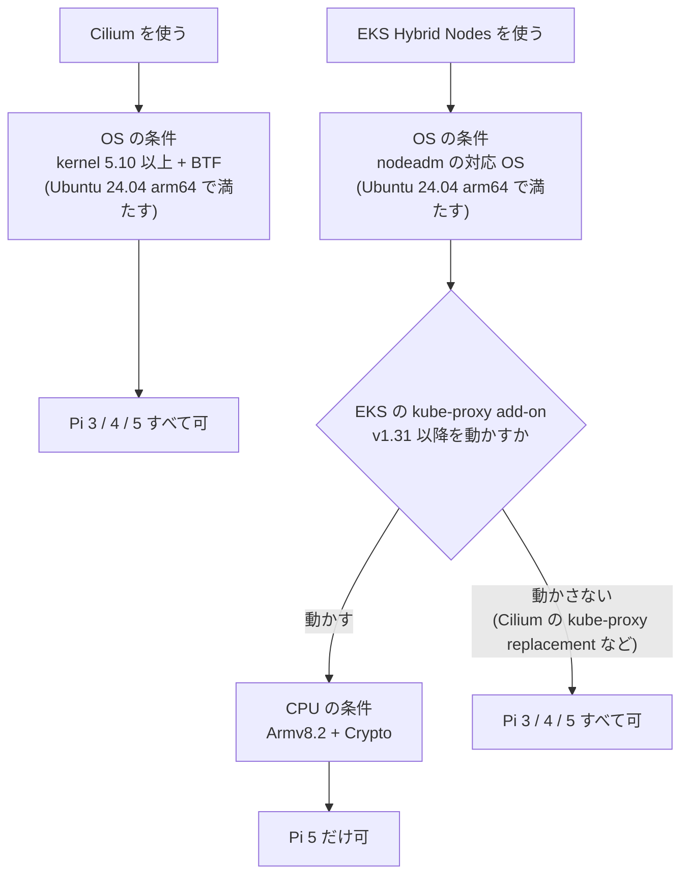

## はじめに

**Raspberry Pi の k3s で Cilium を使う条件は OS だけで決まり、Pi 3〜5 のどれでも満たせます。Pi を EKS Hybrid Nodes のノードにする場合は、これに CPU の条件が加わります。EKS の kube-proxy add-on の v1.31 以降は Armv8.2 と Cryptography Extension を持つ CPU を要求し、Pi 5 より前の機種は満たしません。**

- Cilium に必要なのは kernel 5.10 以上と BTF です。Raspberry Pi OS の現行 kernel は BTF が無いので、Ubuntu Server 24.04 arm64 などに入れ替えます
- EKS Hybrid Nodes の CPU の条件は、OS を更新しても満たせません。Pi 3 / Pi 4 では、EKS の kube-proxy add-on を動かさない構成(Cilium の kube-proxy replacement など)にします

本記事では、この 2 つの条件を、公式ドキュメントを引いて OS で満たせるものと CPU で決まるものに分けて整理します。

想定読者は、Raspberry Pi 上で k3s / Kubernetes を運用していて Cilium (eBPF CNI) や EKS Hybrid Nodes に踏み込もうとしている中級者です。Pi のモデル（3 / 4 / 5）ごとに結論が変わるので、自分の手元のモデルに読み替えてください。

:::message
本記事の文章生成・編集には AI (Anthropic Claude) を活用しています。技術的事実については、筆者が公式ドキュメントを引用して検証しています。誤りや改善点があれば、コメント等でご指摘ください。
:::

## 結論: OS で満たせる条件と CPU で決まる条件

| 条件 | 必要になる場面 | OS の更新で満たせるか | 根拠 |
|---|---|---|---|
| k3s で CNI を差し替えられる | Cilium | — (元から対応) | k3s / Cilium 公式手順 |
| kernel 5.10 以上と BTF | Cilium | ✅ 満たせる | Cilium System Requirements |
| nodeadm の対応 OS | EKS Hybrid Nodes | ✅ 満たせる | EKS 公式 OS 一覧 |
| Armv8.2 + Cryptography Extension | EKS Hybrid Nodes(kube-proxy add-on v1.31 以降) | ❌ 満たせない | EKS 公式、Arm Cortex TRM |

上の 3 つは OS か設定の話なので、OS を入れ替えれば満たせます。最後の 1 つは CPU の命令セットの条件で、OS を更新しても命令は増えません。ただし、この条件が効くのは EKS の kube-proxy add-on を動かすときだけです。



## 前提: k3s は Cilium に対応している

k3s は Cilium に公式に対応しています。k3s は標準で Flannel + kube-proxy を同梱しますが、それらを無効化して Cilium に差し替える構成が用意されています。

[k3s 公式の Custom CNI 手順](https://docs.k3s.io/networking/basic-network-options)によると、

> Start K3s with `--flannel-backend=none` and install your CNI of choice. Most CNI plugins come with their own network policy engine, so it is recommended to set `--disable-network-policy` as well to avoid conflicts.

つまり最低限 `--flannel-backend=none --disable-network-policy` で同梱 CNI を止めます。Cilium の kube-proxy replacement を使うなら、さらに `--disable-kube-proxy` を足す（[Cilium 公式の k3s インストールガイド](https://docs.cilium.io/en/stable/installation/k3s/)）。

```bash
# 出典: https://docs.cilium.io/en/stable/installation/k3s/
# kube-proxy replacement を使う場合は末尾に --disable-kube-proxy を追加
curl -sfL https://get.k3s.io | INSTALL_K3S_EXEC='--flannel-backend=none --disable-network-policy' sh -
```

Cilium 側は podCIDR を k3s の既定値に合わせてインストールします。[同ガイド](https://docs.cilium.io/en/stable/installation/k3s/)のコマンド例は次の通り（バージョンは 2026-06 時点でガイドに記載の `1.19.5`）。

```bash
# 出典: https://docs.cilium.io/en/stable/installation/k3s/
# k3s 既定 podCIDR 10.42.0.0/16 に合わせる
cilium install --version 1.19.5 \
  --set=ipam.operator.clusterPoolIPv4PodCIDRList="10.42.0.0/16"
```

[Cilium の k3s ガイド](https://docs.cilium.io/en/stable/installation/k3s/)は amd64 と arm64 の両アーキテクチャをサポートすると明記しており、arm64 の Raspberry Pi も対象に入ります。「k3s で Cilium が動くか？」の答えは Yes（公式手順あり）です。

残る条件は、手元の Pi の OS と CPU が要件を満たすかどうかです。

## OS 更新で直る制約

### 1. EKS Hybrid Nodes の対応 OS

EKS Hybrid Nodes のノードは、nodeadm が対応する OS でなければサポートされません。[Prepare operating system for hybrid nodes](https://docs.aws.amazon.com/eks/latest/userguide/hybrid-nodes-os.html) の検証済み OS は Amazon Linux 2023 / Ubuntu 20.04・22.04・24.04 / RHEL 8・9 などです。

Raspberry Pi で対応マトリクスに沿うなら、Raspberry Pi OS ではなく Ubuntu Server 24.04 LTS の arm64 を入れる方法があります。これは OS の条件なので、OS を入れ替えれば満たせます。

### 2. Cilium の kernel 要件

Cilium の eBPF データパスには新しめの kernel と BTF(BPF Type Format。カーネルが構造体レイアウトを公開する型情報で、CO-RE=Compile Once – Run Everywhere 方式の eBPF プログラムがカーネル差分を吸収するために必要)が要ります。[Cilium System Requirements](https://docs.cilium.io/en/stable/operations/system_requirements/) は最小要件を次のように定めています。

> Linux kernel >= 5.10 or equivalent (e.g., 4.18 on RHEL 8.10)

加えて、eBPF まわりの kernel config が必要です（[同ページ](https://docs.cilium.io/en/stable/operations/system_requirements/)）。

```text
# 出典: https://docs.cilium.io/en/stable/operations/system_requirements/
CONFIG_DEBUG_INFO_BTF=y   # BTF（CO-RE に必須）
CONFIG_BPF=y
CONFIG_BPF_SYSCALL=y
CONFIG_CGROUP_BPF=y
```

Ubuntu 24.04 LTS は kernel 6.8 系で、これらを満たします。古い Raspberry Pi OS のままだと kernel が古かったり BTF 無効だったりしますが、これも OS / kernel を更新すれば解決します。

実際にこの「BTF 無効」は、Raspberry Pi OS の現行 kernel が該当します。手元の Pi（Raspberry Pi OS bookworm, `6.6.62+rpt-rpi-2712`）で確認すると、`CONFIG_BPF` 系は有効な一方で BTF が完全に欠けていることがわかります。

```console
$ grep -E 'CONFIG_BPF=|CONFIG_BPF_SYSCALL|CONFIG_CGROUP_BPF|CONFIG_DEBUG_INFO_BTF' \
    /boot/config-6.6.62+rpt-rpi-2712
CONFIG_BPF=y
CONFIG_BPF_SYSCALL=y
CONFIG_CGROUP_BPF=y
# CONFIG_DEBUG_INFO_BTF が無い（未設定）

$ ls /sys/kernel/btf/vmlinux
ls: cannot access '/sys/kernel/btf/vmlinux': No such file or directory
```

kernel バージョンは 6.6 で 5.10+ の要件を満たしているのに、BTF だけが欠けているため、[Cilium System Requirements](https://docs.cilium.io/en/stable/operations/system_requirements/) の必須項目 `CONFIG_DEBUG_INFO_BTF=y` を満たせません。この状態で k3s の flannel を外して Cilium を入れると、Cilium agent が CO-RE の eBPF プログラムをロードできず、ノードが Ready になりません。つまり CPU 世代（Armv8.2-A）以前に、OS 層の BTF 欠如で Cilium が動かないわけです。逆に言えば、これは「OS 層の制約」であり、Ubuntu 24.04 arm64（BTF 有効）へ載せ替えれば解消します。

:::message
ここまでの 2 つは、OS を Ubuntu 24.04 arm64 にすれば両方とも満たせます。
:::

## OS の更新で満たせない条件: Armv8.2 と Cryptography Extension

**EKS の kube-proxy add-on の v1.31 以降は、Armv8.2 と Cryptography Extension を持つ CPU を要求し、Pi 5 より前の機種では起動しません。** [Prepare operating system for hybrid nodes](https://docs.aws.amazon.com/eks/latest/userguide/hybrid-nodes-os.html)(2026-10 時点で取得)の ARM の節に、次のとおり書かれています。

> All Raspberry Pi systems prior to the Raspberry Pi 5, as well as Cortex-A72 based processors, do not meet this requirement.

この条件に合わない CPU では、kube-proxy のログに次のエラーが出ると、同じページに書かれています。

```text
Fatal glibc error: This version of Amazon Linux requires a newer ARM64 processor compliant with at least ARM architecture 8.2-a with Cryptographic extensions. On EC2 this is Graviton 2 or later.
```

同じページは、回避策として kube-proxy add-on の v1.30 を使い続ける方法と、upstream の kube-proxy イメージを使う方法を挙げています。v1.30 は 2026 年 7 月に延長サポートが終わったので、今の選択肢は upstream のイメージです。

これは CPU の命令セット世代の問題で、OS や kernel をいくら新しくしても直らません。実装されていない命令をソフトウェアで補うことはできないためです。

Raspberry Pi のメイン CPU は世代ごとに Arm アーキテクチャのバージョンが違います。

| Pi モデル | CPU コア | Arm アーキテクチャ | Armv8.2-A |
|---|---|---|---|
| Raspberry Pi 3 | Cortex-A53 | Armv8-A（v8.0） | ❌ 無い |
| Raspberry Pi 4 | Cortex-A72 | Armv8-A（v8.0） | ❌ 無い |
| Raspberry Pi 5 | Cortex-A76 | Armv8.2-A | ✅ ある |

各コアのアーキテクチャは Arm 公式の Technical Reference Manual に明記されています。

- Cortex-A76 は 「a full implementation of the Armv8.2-A A64, A32, and T32 instruction sets」（[Arm Cortex-A76 Core TRM (100798)](https://support.arm.com/documentation/100798/latest/)）
- Cortex-A72 は 「a full implementation of the ARMv8-A architecture profile」（[Arm Cortex-A72 MPCore TRM (100095)](https://support.arm.com/documentation/100095/latest)）
- Cortex-A53 は Armv8-A の実装（[Arm Cortex-A53 MPCore TRM (DDI0500)](https://support.arm.com/documentation/ddi0500/latest/)）

そして各 Pi がどの CPU を積むかは Raspberry Pi 公式仕様に載っています。

- Raspberry Pi 5 = Cortex-A76（[Raspberry Pi 5 product page](https://www.raspberrypi.com/products/raspberry-pi-5/)）
- Raspberry Pi 4 Model B = Cortex-A72（[Raspberry Pi 4 specifications](https://www.raspberrypi.com/products/raspberry-pi-4-model-b/specifications/)）
- Raspberry Pi 3 Model B+ = Cortex-A53（[Raspberry Pi 3 B+ product page](https://www.raspberrypi.com/products/raspberry-pi-3-model-b-plus/)）

整理すると、Armv8.2-A を要求する EKS の kube-proxy add-on(v1.31 以降)は、Armv8-A までの Pi 3 / Pi 4 では動きません。Pi 5（A76）だけが Armv8.2-A を持ちます。これは CPU の実装で決まるため、OS 更新では解消できません。

## Pi 3 / Pi 4 での回避策

**Pi 3 / Pi 4 でも、EKS の kube-proxy add-on を動かさなければ、この CPU の条件は出ません。**

| 回避策 | 仕組み | 注意 |
|---|---|---|
| Cilium の kube-proxy replacement | kube-proxy を動かさない | k3s では servicelb と Traefik を無効にする |
| upstream の kube-proxy イメージ | EKS の add-on ではないイメージを使う | AWS が案内する方法 |
| kube-proxy add-on v1.30 | 条件が入る前の版 | 2026-07 に延長サポートが終了 |

1. **Cilium の kube-proxy replacement を使う**
   kube-proxy の代わりに Cilium が Service の振り分けを行います([Cilium 公式の kube-proxy replacement](https://docs.cilium.io/en/stable/network/kubernetes/kubeproxy-free/))。k3s では、servicelb と Traefik も無効にしてください。どちらも k3s が標準で入れる部品です([k3s: Networking Services](https://docs.k3s.io/networking/networking-services))。
   - **Traefik**: HTTP のリバースプロキシで、k3s では Ingress を処理します。ポート 80 と 443 を使う LoadBalancer の Service として起動します
   - **servicelb**: クラウドのロードバランサが無い環境で LoadBalancer の Service を使えるようにする k3s の仕組みです。ノードのポートを使い、ノードの IP を Service の外部アドレスに書き込みます

   筆者環境(Pi 5、Ubuntu 26.04、2026-07)では、これを無効にし忘れて、外から SSH が届かなくなりました。servicelb が Traefik の Service にノードの IP を割り当て、Cilium の kube-proxy replacement がそのノードの IP を「振り分け先の無いサービスの宛先」として扱い、SSH などサービス以外の通信まで捨てたためです。k3s の起動オプションに `--disable=servicelb --disable=traefik` を足すと直りました。Ingress が必要なら、ノードの IP を使わない Cilium の LoadBalancer の機能などで代わりを用意します
2. **upstream の kube-proxy イメージを使う**
   AWS の同じページが案内する方法です

## Pi モデル別の結論

| モデル | CPU / 命令セット | Cilium | EKS Hybrid Nodes |
|---|---|---|---|
| Pi 5 | Cortex-A76 / Armv8.2-A | OS の入れ替えで可 | OS の入れ替えで可 |
| Pi 4 | Cortex-A72 / Armv8-A | OS の入れ替えで可 | kube-proxy add-on を使わなければ可 |
| Pi 3 | Cortex-A53 / Armv8-A | 可(常用は非推奨) | 同左(常用は非推奨) |

- **Raspberry Pi 5（Cortex-A76 / Armv8.2-A）**: 命令セットの制約がありません。Ubuntu 24.04 arm64 化すれば nodeadm 対応・Cilium kernel 要件・Armv8.2-A をすべて満たします。Hybrid Node 候補として最有力です。
- **Raspberry Pi 4（Cortex-A72 / Armv8-A）**: OS を Ubuntu 24.04 arm64 にすれば、nodeadm と Cilium の条件は満たせます。EKS Hybrid Nodes では、EKS の kube-proxy add-on の代わりに、Cilium の kube-proxy replacement か upstream の kube-proxy イメージを使います。
- **Raspberry Pi 3（Cortex-A53 / Armv8-A）**: OS 更新で要件自体は満たせますが、CPU が非力でメモリも少ない個体が多く、Cilium + Hybrid Node 常駐は重いです。検証はできても常用は Pi 4 / 5 を推奨します。

## まとめ

1. Raspberry Pi で Cilium を使う条件は OS(kernel 5.10 以上と BTF)だけで決まります。Raspberry Pi OS の現行 kernel は BTF が無いので、Ubuntu 24.04 arm64 などに入れ替えます
2. EKS Hybrid Nodes では、nodeadm の対応 OS に加えて、EKS の kube-proxy add-on v1.31 以降が Armv8.2 と Cryptography Extension を要求します。Pi 5 より前の機種は満たさず、OS の更新でも直りません
3. Pi 3 / Pi 4 では、Cilium の kube-proxy replacement か upstream の kube-proxy イメージを使い、EKS の kube-proxy add-on を動かさない構成にします。k3s で kube-proxy replacement を使うときは、servicelb と Traefik を無効にします
4. どちらの条件もそのまま満たすのは Pi 5(Cortex-A76 / Armv8.2-A)です

## 参考

- 検証時の構成ファイル: [cilium](https://github.com/shinichitazawa/k8s-deploy-public/tree/main/cilium)（[k8s-deploy-public](https://github.com/shinichitazawa/k8s-deploy-public) の main 時点。環境固有値はダミーに置換済み）

- [k3s: Basic Network Options（Custom CNI）](https://docs.k3s.io/networking/basic-network-options)
- [Cilium: Installation on k3s](https://docs.cilium.io/en/stable/installation/k3s/)
- [Cilium: System Requirements](https://docs.cilium.io/en/stable/operations/system_requirements/)
- [Cilium: Kubernetes without kube-proxy](https://docs.cilium.io/en/stable/network/kubernetes/kubeproxy-free/)
- [Amazon EKS: Prepare operating system for hybrid nodes](https://docs.aws.amazon.com/eks/latest/userguide/hybrid-nodes-os.html)
- [Arm Cortex-A76 Core Technical Reference Manual (100798)](https://support.arm.com/documentation/100798/latest/)
- [Arm Cortex-A72 MPCore Technical Reference Manual (100095)](https://support.arm.com/documentation/100095/latest)
- [Arm Cortex-A53 MPCore Technical Reference Manual (DDI0500)](https://support.arm.com/documentation/ddi0500/latest/)
- [Raspberry Pi 5 product page](https://www.raspberrypi.com/products/raspberry-pi-5/)
- [Raspberry Pi 4 Model B specifications](https://www.raspberrypi.com/products/raspberry-pi-4-model-b/specifications/)
- [Raspberry Pi 3 Model B+ product page](https://www.raspberrypi.com/products/raspberry-pi-3-model-b-plus/)
