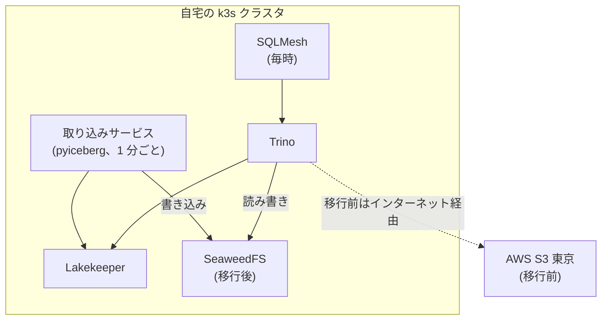

## はじめに

自宅の Kubernetes クラスタで動かしている Iceberg のレイクハウスについて、保存先を AWS S3 からクラスタ内の SeaweedFS へ移しました。きっかけは転送料です。Grafana のアラート 1 本が原因で、4 日間に約 $330 の S3 転送料がかかりました。

移行は約 16 分で終わりました。書き込み先を切り替えるときに取り込みサービスを 1 回再起動した以外は、取り込みも変換も止めていません。行数は全テーブルで一致し、切り替え後の最初の毎時処理でも、元データと集計結果の行数が一致しました。本記事では、転送料が膨らんだ経緯と、Lakekeeper の warehouse を 2 つ並べて行った移行の手順、移行中に実測で分かった Lakekeeper と Iceberg の挙動を記録します。

| 項目 | 版・構成 |
|---|---|
| Lakekeeper | v0.13.3(OSS 版。Helm chart 0.12.0) |
| Trino | 483(coordinator 1 台がワーカーも兼ねる) |
| 取り込み | pyiceberg 0.12.0 を使う自作サービス。1 分ごとに追記 |
| 変換 | SQLMesh。bronze → silver → gold を毎時 |
| SeaweedFS | 4.48(`weed mini`、1 Pod、耐久性なし) |
| クラスタ | k3s。Raspberry Pi の control plane と x86_64 のワーカー 1 台 |

扱わないものは次のとおりです。

- クエリ性能の比較
- 一時認証情報の払い出しの仕組み(保存先が変わっても、クライアントに鍵を持たせない構成はそのまま使えました)
- Lakekeeper の Generic Tables(Iceberg 以外の形式の登録)。試していません

:::message
本記事の文章生成・編集には AI (Anthropic Claude) を活用しています。技術的事実は筆者が公式ドキュメントを引用して検証していますが、誤りや改善点があればコメント等でご指摘ください。
:::

## 構成



Lakekeeper は Iceberg の REST カタログです。テーブルの一覧とメタデータの場所を管理し、データファイルそのものはクライアント(Trino と取り込みサービス)が保存先を直接読み書きします。

## 転送料が膨らんだ経緯

2026-10-01 に、Grafana のアラートを 1 本追加しました。silver テーブルの鮮度を見るもので、評価は 1 分ごとです。Trino でこのクエリを 1 回流すたびに、Trino の Pod は約 977MB を受信していました(Pod の `/proc/net/dev` の差分で計測)。

その結果、S3 からのインターネット向け転送(使用タイプ `APN1-DataTransfer-Out-Bytes`)が次のように増えました。金額は筆者の AWS Cost Explorer の値です。

| 日 | 転送量 | 金額 |
|---|---:|---:|
| 2026-09-25〜09-30 | 1 日 0.6〜9.3 GB | ほぼ $0(無料枠の範囲内) |
| 2026-10-01 | 212.9 GB | $12.87 |
| 2026-10-02 | 737.7 GB | $84.10 |
| 2026-10-03 | 935.2 GB | $106.62 |
| 2026-10-04 | 1,108.6 GB | $126.38 |

請求から逆算した単価は 1 GB あたり $0.114 でした。AWS Cost Anomaly Detection の週次メールで気づき、アラートのデータ元を PostgreSQL(SQLMesh の処理記録)に替えて止めました。

原因の特定では、次の 2 点に注意が必要でした。

- **Trino の統計は実際の受信量を大きく下回りました。** 同じクエリの `EXPLAIN ANALYZE` の「Physical input」は 173MB で、実際の受信量(977MB)の 5 分の 1 以下でした。読み出し量の見積もりには、Pod の受信バイト数を使いました
- **時間帯の偏りで出どころを絞りました。** NetObserv(eBPF のフロー計測)で Trino の外部受信量を分ごとに集計すると、1 時間のどの分もほぼ均等でした。毎時のジョブではなく、毎分動くものが読んでいると分かりました

[S3 の料金ページ](https://aws.amazon.com/s3/pricing/)では、同じリージョン内の AWS サービスへの転送は課金されないとされています。クエリエンジンを AWS の外に置く構成では、この扱いを受けられません。定期的に動くクエリが 1 本あるだけで転送料が積み上がるので、保存先をクラスタの中に移すことにしました。

## Lakekeeper の warehouse を 2 つ並べる

Lakekeeper では、保存先の設定は warehouse 単位です。既存の warehouse(AWS S3)を残したまま、SeaweedFS を保存先とする warehouse を 1 つ追加しました。Trino には warehouse ごとにカタログを作り、両方を同時に読み書きできる状態にしてから移行しました。

S3 互換ストレージ用の storage-profile は次のとおりです。

```json:storage-profile
{
  "type": "s3",
  "bucket": "lakehouse",
  "key-prefix": "warehouse",
  "region": "local",
  "flavor": "s3-compat",
  "endpoint": "http://seaweedfs.seaweedfs.svc.cluster.local:8333",
  "path-style-access": true,
  "sts-enabled": true
}
```

`region` は [Lakekeeper v0.13.3 のストレージ設定](https://github.com/lakekeeper/lakekeeper/blob/v0.13.3/docs/docs/storage.md)に「For S3-compatible storage, any string can be used」とあり、任意の文字列で構いません。同じ文書には「When creating a Warehouse or updating storage information, Lakekeeper validates the configuration.」とあり、warehouse を作った時点で保存先に読み書きできることが確かめられます。今回は一度で作成できました。

SeaweedFS は、master・volume・filer・S3 を 1 プロセスで動かす `weed mini` で起動しました。Lakekeeper の CI もこの `weed mini` を相手に試験しています([seaweedfs.yml](https://github.com/lakekeeper/lakekeeper/blob/main/.github/workflows/seaweedfs.yml))。

## ファイルのコピーでは移せない

Iceberg のメタデータには、データファイルの場所が完全なパスで書き込まれています。[Iceberg の仕様](https://github.com/apache/iceberg/blob/main/format/spec.md)にも次のようにあります。

> Prior to v4, all path fields must contain fully-qualified paths.

今のテーブルは format version 2 です。AWS S3 のファイルを SeaweedFS にコピーしても、メタデータは AWS S3 のパスを指したままになります。そのため、Trino で旧 warehouse のテーブルを読み、新 warehouse のテーブルに書き直しました。

## 取り込みを止めずに移す

取り込みサービスは 1 分ごとに bronze へ追記し、SQLMesh は毎時 0 分に直前の 1 時間分を silver・gold に変換します。取り込みサービスの再起動 1 回を除いて両方を止めずに移すため、次の順にしました。

| 手順 | 時刻(UTC) | 結果 |
|---|---|---|
| 1. 取り込みサービスの書き込み先を新 warehouse に切り替える | 10:10 | 旧 bronze への書き込みは 10:09:56 で止まった。新 bronze のテーブルは取り込みサービスが自分で作成 |
| 2. 旧 bronze を 1 日ずつ `INSERT ... SELECT` で新 bronze に追記 | 10:10〜10:16 | 11 日分、67,565,624 行。日ごとの行数が一致 |
| 3. silver・gold の実体を同じ手順で書き直し、ビュー 5 つを作り直す | 〜10:25 | 件数がすべて一致 |
| 4. Trino のカタログ名を入れ替える | 10:26 | 新 warehouse を元の名前 `lakehouse` に。旧側は別名で残した |

順番には次の理由があります。

- **書き込み先を先に切り替えました。** 切り替え前に旧側へ書かれた行と、切り替え後に新側へ書かれた行は重ならないので、旧 bronze を全部追記すれば重複も欠けも出ません
- **カタログ名を最後に入れ替えました。** SQLMesh・Grafana・ビューの定義は `lakehouse` という名前で参照しているので、名前を入れ替えるだけで全部が新側を読むようになります
- **全体を 1 時間以内に収めました。** SQLMesh は毎時 0 分に、直前の 1 時間分を bronze から読みます。10:00 の処理が終わった直後に始め、11:00 より前に名前の入れ替えまで終えました。11:00 の処理が旧 bronze(10:10 以降は増えない)を読むと、10 時台の集計が欠けるためです
- **コピーは 1 日ずつにしました。** Trino のノードあたりのクエリメモリが 1GB で、全期間を 1 本のクエリで書くと上限を超える恐れがあったためです

コピーで AWS S3 から読んだ量は約 3GB で、転送料は約 $0.35 です。11:00 の処理のあと、10 時台の silver と bronze の行数は一致しました(どちらも 332,011 行)。

## 実測で判明した挙動

| 挙動 | 実測 | 理由・対処 |
|---|---|---|
| 消したテーブルが 7 日残る | テーブルを消しても、名前空間の削除が「Namespace with name 'smoke' is not empty」で失敗する | warehouse の削除方式を soft(7 日後に完全削除)にしているため |
| クライアントにファイル削除を許可しない | 取り込みサービス(pyiceberg)が、コミットのたびに「Failed to delete metadata file」と警告を出す | 下記 |
| endpoint の末尾に `/` が付く | 作成時に渡した `...:8333` が、warehouse の一覧では `...:8333/` になる | 設定を宣言と突き合わせる処理では、末尾をそろえて比べる |
| SeaweedFS のメモリ不足 | コピー中に 4 回強制終了(上限 1Gi、直前の使用量は 800〜880MiB) | 上限を 2Gi に上げた。取り込みサービスはバッファから書き直し、取りこぼしは 0 |

### 古いファイルを誰が消すのか

Lakekeeper は、soft 削除の warehouse では、クライアントにファイル削除を許可しない指定を渡します。[ストレージ設定](https://github.com/lakekeeper/lakekeeper/blob/v0.13.3/docs/docs/storage.md)の `push-s3-delete-disabled`(既定 `true`)の説明は次のとおりです。

> Controls whether the `s3.delete-enabled=false` flag is sent to clients. Only has an effect if "soft-deletion" is enabled for this Warehouse.

同じ説明は、この指定が `expire_snapshots` のようなファイルの削除を伴う操作にも影響する、と続いています。古い版の削除は Trino の `expire_snapshots` と `remove_orphan_files`(保持期間 7 日)で毎日動かしているので、旧 AWS 側のテーブルで、ファイルが本当に消えているかを確かめました。

| 対象 | 置かれているもの | 解釈 |
|---|---|---|
| 09-26 のパーティションのデータ | 3 ファイル(テーブルが参照しているのは 1 ファイル) | 1 分ごとの小さいファイル(1 日 1,440 個)は消えている。残る 2 個は直近の結合で置き換わった版 |
| メタデータ(manifest とその一覧) | 09-28 以降の 26,695 個(約 269MB) | 7 日より古いものは消えている |
| `metadata.json` | 21 個 | 直近の版だけが残っている |

pyiceberg の警告は出続けますが、Trino で動かしている削除処理は効いていました。

### 古い版が占める容量

移行後の bronze で、今の版が参照しているデータと、保持中の全版が参照しているデータを比べました(移行後 3 時間 40 分の時点)。

| | ファイル数 | 容量 |
|---|---:|---:|
| 今の版が参照 | 70 | 1,606.6 MB |
| 保持中の全版(234 個)が参照 | 271 | 1,997.9 MB(+24%) |
| メタデータ(manifest) | 424 | 4.35 MB |

版の内訳は、追記が 231 個、ファイルの結合が 3 個でした。追記は新しいファイルを足すだけで、既存のファイルは全版で共有されます。結合では、まとめ直した新しいファイルができる一方、古いファイルも過去の版から参照されて残ります。+24% はこの分です。保存先の容量は、今のデータに 7 日分の古い版を足した量になります。

## まとめ

- AWS の外にあるクエリエンジンから S3 を読むと、読んだ分がすべて転送料になります。1 分ごとのアラート 1 本で、1 日 $100 を超えました
- 読み出し量は Trino の統計ではなく、Pod の受信バイト数で測りました。統計は実際の 5 分の 1 以下でした
- Iceberg v2 のメタデータはファイルの完全なパスを持つので、保存先を移すにはテーブルを書き直す必要がありました。Lakekeeper の warehouse を 2 つ並べ、Trino で書き直しました
- 書き込み先の切り替え → コピー → カタログ名の入れ替えの順にし、約 16 分で移せました。止めたのは取り込みサービスの再起動 1 回だけで、行数は全テーブルで一致しました
- Lakekeeper はクライアントにファイル削除を許可しませんが、Trino で動かす古い版の削除は効いていました

## 参考

- 検証時の構成ファイル: [lakekeeper](https://github.com/shinichitazawa/k8s-deploy-public/tree/main/lakekeeper) / [seaweedfs](https://github.com/shinichitazawa/k8s-deploy-public/tree/main/seaweedfs) / [trino](https://github.com/shinichitazawa/k8s-deploy-public/tree/main/trino) / [flow-ingest(pyiceberg の取り込みサービス)](https://github.com/shinichitazawa/k8s-deploy-public/tree/main/flow-ingest)([k8s-deploy-public](https://github.com/shinichitazawa/k8s-deploy-public)。環境固有値はダミーに置換済み)

- [Lakekeeper v0.13.3: Storage](https://github.com/lakekeeper/lakekeeper/blob/v0.13.3/docs/docs/storage.md)
- [Lakekeeper: SeaweedFS Tests(CI)](https://github.com/lakekeeper/lakekeeper/blob/main/.github/workflows/seaweedfs.yml)
- [Apache Iceberg: Table Spec](https://github.com/apache/iceberg/blob/main/format/spec.md)
- [SeaweedFS 4.48](https://github.com/seaweedfs/seaweedfs/releases/tag/4.48)
- [Amazon S3 の料金](https://aws.amazon.com/s3/pricing/)
