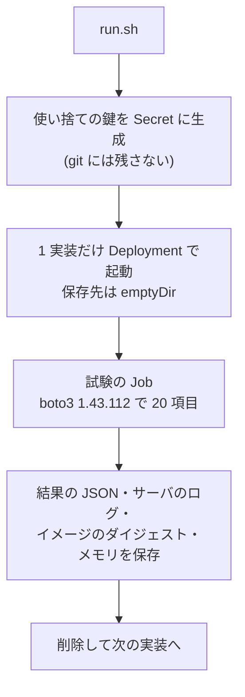

## はじめに

S3 互換を名乗る 4 つのオープンソース実装を、同じ k3s クラスタで 1 つずつ立て、同じ 20 項目の S3 リクエストを最新の boto3 の既定の設定のまま投げました。結論は次のとおりです。

- 基本の操作(バケット・PUT/GET・一覧・署名付き URL・コピー・一括削除)は 4 つとも通りました
- 差が出たのは周辺の機能です。**Garage はタグ・バージョニング・バケットポリシー・Object Lock が `NotImplemented`** で、**条件付き書き込み(`If-None-Match: *`)が上書きを止めませんでした**
- **Garage のマルチパートアップロードは、SDK の既定のチェックサムでは `InvalidDigest` で失敗し、`when_required` にすると成功**しました。[2025 年に AWS SDK が既定を変えたときに互換実装で起きた種類の問題](https://github.com/aws/aws-sdk-go-v2/discussions/2960)が、2026-10 時点の最新版の組み合わせで再現しています
- **MinIO はオープンソース版のリポジトリがアーカイブされ、コンテナイメージの配布も終わっています**。今回はソースからビルドして試験しました

前提となる「S3 互換とは何を指すのか」は、別記事 `034-s3-protocol-deep-dive` で扱っています。

- 想定読者: 自前でオブジェクトストレージを立てる候補を比べている開発者
- 実施日: 2026-10-13。試験は各実装 1 回ずつで、性能・耐久性・分散構成は試していません(「試していないこと」の節)

:::message
本記事の文章生成・編集には AI (Anthropic Claude) を活用しています。試験は筆者の k3s クラスタで実行し、結果の JSON とサーバのログを証跡として残しています。誤りや改善点があれば、コメント等でご指摘ください。
:::

## 試験の方法



| 項目 | 内容 |
|---|---|
| クラスタ | k3s v1.36.2+k3s1。試験はすべて同じノード(x86_64、8 コア、Ubuntu 26.04 LTS)に固定 |
| 試験の Job | `python:3.14-slim` に boto3 1.43.112(実施時点の最新)を入れて実行。path-style でアクセス |
| チェックサム | 既定(`when_supported`)のまま。比較のため一部の項目だけ `when_required` でも実行 |
| 起動方法 | 4 つとも単一ノード・単一プロセスの最小構成。保存先は emptyDir |
| 同時に動かす数 | 1 つだけ。同じノードで別のデータベースが動いているため、1 つずつ立てて消しています |

試験した版は次のとおりです。

| 実装 | 版 | イメージ |
|---|---|---|
| [SeaweedFS](https://github.com/seaweedfs/seaweedfs) | 4.48 | `chrislusf/seaweedfs:4.48@sha256:4e61d15f…` |
| [RustFS](https://github.com/rustfs/rustfs) | 1.0.1 | `rustfs/rustfs:1.0.1@sha256:1803faef…` |
| [Garage](https://git.deuxfleurs.fr/Deuxfleurs/garage) | v2.4.1 | `dxflrs/garage:v2.4.1@sha256:9c96caa2…` |
| [MinIO](https://github.com/minio/minio) | RELEASE.2025-10-15T17-29-55Z | 公式のイメージが無いため、リリースのタグからビルド(後述) |

## 結果

`OK` は成功、それ以外は返ってきた S3 のエラーコードと HTTP ステータスです。

| # | 項目 | SeaweedFS | RustFS | Garage | MinIO |
|---|---|---|---|---|---|
| T01 | CreateBucket | OK | OK | OK | OK |
| T02 | ListBuckets | OK | OK | OK | OK |
| T03 | PutObject(既定のチェックサム) | OK | OK | OK | OK |
| T04 | PutObject(`when_required`) | OK | OK | OK | OK |
| T05 | GetObject(既定の応答検証) | OK | OK | OK | OK |
| T06 | HeadObject と Range GET | OK | OK | OK | OK |
| T07 | ListObjectsV2 のページ送り | OK | OK | OK | OK |
| T08 | マルチパート 2 × 5 MiB(既定のチェックサム) | OK | OK | **InvalidDigest / 400** | OK |
| T08b | マルチパート 2 × 5 MiB(`when_required`) | OK | OK | OK | OK |
| T09 | 署名付き URL での GET | OK | OK | OK | OK |
| T10 | CopyObject | OK | OK | OK | OK |
| T11 | DeleteObjects(一括) | OK | OK | OK | OK |
| T12 | オブジェクトのタグ | OK | OK | NotImplemented / 501 | OK |
| T13 | バージョニング | OK | OK | NotImplemented / 501 | OK |
| T14 | ライフサイクル設定 | OK | OK | OK | OK |
| T15 | 条件付き書き込み `If-None-Match: *` | OK(2 回目は 412) | OK(2 回目は 412) | **上書きされた** | OK(2 回目は 412) |
| T16 | バケットポリシー | OK | OK | NotImplemented / 501 | OK |
| T17 | CORS 設定 | OK | OK | OK | NotImplemented / 501 |
| T18 | SSE-S3(`AES256`) | InternalError / 500 | InvalidRequest / 400 | OK | NotImplemented / 501 |
| T19 | Object Lock と保持期間 | OK | OK | NotImplemented / 501 | OK |
| | **成功数** | **19 / 20** | **19 / 20** | **14 / 20** | **18 / 20** |

## 差が出た項目の中身

### Garage のマルチパートは既定のチェックサムで失敗する

既定の設定のまま 2 パートをアップロードし、完了の要求を送ったところで失敗しました。返ってきたメッセージは次のとおりです。

```text
InvalidDigest (400): Invalid digest: Invalid checksum for part 1: in request = Some(Crc32([16, 82, 177, 163])), uploaded part = None
```

boto3 は既定で、各パートと完了の要求に CRC32 のチェックサムを付けます。Garage はパートの側のチェックサムを保持しておらず(`uploaded part = None`)、完了の要求に付いた値と照合できずに拒否しています。同じ手順を `request_checksum_calculation="when_required"` で実行すると成功しました(T08b)。

回避策は、AWS が用意している設定で、チェックサムを必要なときだけ付けるようにすることです([AWS SDKs and Tools: Data Integrity Protections](https://docs.aws.amazon.com/sdkref/latest/guide/feature-dataintegrity.html))。

```bash
export AWS_REQUEST_CHECKSUM_CALCULATION=when_required
export AWS_RESPONSE_CHECKSUM_VALIDATION=when_required
```

単一の PutObject(T03)は既定のままでも通ったので、**小さいファイルだけの試験では見つからず、大きいファイルを分割アップロードしたときに初めて表に出る**点に注意が必要です。

### Garage は条件付き書き込みで上書きを止めない

`If-None-Match: *` は「同じキーのオブジェクトがまだ無いときだけ書く」という指定です。SeaweedFS・RustFS・MinIO は 2 回目の書き込みを `PreconditionFailed (412)` で拒否しました。Garage は 2 回目も成功し、オブジェクトは上書きされました。

エラーにならず黙って上書きされるので、この指定で排他(ロックの代わり)をしているアプリを Garage に載せると、競合を検知できません。

### Garage は未実装の API を 501 で返す

タグ・バージョニング・バケットポリシー・Object Lock は `NotImplemented (501)` でした。メッセージは `Unimplemented action: PutObjectTagging` のように、どの操作が未実装かを明示しています。Garage は設計の目標として小規模な自前運用と地理的な分散を挙げていて、冗長化も複製だけに絞っています。

> Storage optimizations: erasure coding or any other coding technique both increase the difficulty of placing data and synchronizing; we limit ourselves to duplication.
>
> — [Garage: Goals and use cases](https://garagehq.deuxfleurs.fr/documentation/design/goals/)、2026-10 時点で取得

### SSE-S3 は鍵の設定が無いと実装ごとに違う失敗をする

`ServerSideEncryption="AES256"` を付けた PutObject は、暗号化の鍵を何も設定していない状態では次のようになりました。

| 実装 | 結果 | 内容 |
|---|---|---|
| SeaweedFS | InternalError / 500 | 応答は汎用のメッセージだけ。サーバのログには `putVersionedObject failed with errCode=30` が出ていました |
| RustFS | InvalidRequest / 400 | `SSE-S3 requires RUSTFS_SSE_S3_MASTER_KEY to be set to a base64-encoded 32-byte key when KMS is not configured` |
| MinIO | NotImplemented / 501 | `Server side encryption specified but KMS is not configured` |
| Garage | OK | 要求は受け付けられました。保存時に実際に暗号化されたかは、今回は確かめていません |

RustFS と MinIO は、何を設定すればよいかを応答で示しています。SeaweedFS は 500 を返すので、利用者の側では原因がわかりません。

### MinIO は CORS の設定を受け付けない

MinIO は `PutBucketCors` に `NotImplemented (501)` を返しました(`A header you provided implies functionality that is not implemented`)。ほかの 3 つは設定と取得ができました。

## 実装の違い

試験の結果とは別に、各リポジトリの公開情報で確認した違いです(2026-10-13 時点)。

| | SeaweedFS | RustFS | Garage | MinIO |
|---|---|---|---|---|
| 言語 / ライセンス | Go / Apache-2.0 | Rust / Apache-2.0 | Rust / AGPL-3.0 | Go / AGPL-3.0 |
| 開発の状態 | 活発 | 活発 | 活発 | **リポジトリはアーカイブ済み** |
| データの持ち方 | ボリュームサーバに小さいファイルをまとめて詰める([README](https://github.com/seaweedfs/seaweedfs)) | Erasure Set による消失訂正符号([README](https://github.com/rustfs/rustfs)) | 複製だけ(上の引用) | 消失訂正符号([MinIO Erasure Code Overview](https://docs.min.io/community/minio-object-store/operations/concepts/erasure-coding.html)、現在は AIStor の文書へ転送) |
| S3 以外の窓口 | POSIX ファイルシステム、WebDAV、Iceberg REST カタログ | Iceberg REST カタログ(Preview)、FTPS、WebDAV | なし | なし |

Iceberg のカタログを内蔵しているのは SeaweedFS と RustFS で、RustFS の README は S3 Tables(Iceberg REST)を `🧪 Preview` としています([rustfs/rustfs README](https://github.com/rustfs/rustfs))。どの実装も、外部のカタログと組み合わせれば Iceberg のデータの置き場所として使えます。内蔵のカタログは今回試していません。

### MinIO はソースからビルドしないと試せない

MinIO のリポジトリの README は、冒頭で保守の終了を告げています。

> THIS REPOSITORY IS NO LONGER MAINTAINED.
>
> — [minio/minio README](https://github.com/minio/minio)、2026-10 時点で取得

代わりに案内されているのは商用の AIStor(無償版と有償版)です。最後のリリース(RELEASE.2025-10-15T17-29-55Z)のノートには、コンテナについて次のように書かれています。

> For container environments, please clone the source and build the latest container.
>
> — [minio/minio Releases](https://github.com/minio/minio/releases/tag/RELEASE.2025-10-15T17-29-55Z)、2026-10 時点で取得

Docker Hub の `minio/minio` も取得できませんでした(2026-10-13 時点で「object not found」)。今回は、上流の Makefile と同じビルドの指定(`CGO_ENABLED=0`、`-tags kqueue`、`-trimpath`、版の情報を埋める ldflags)で、リリースのタグからイメージを作りました。ビルドの定義も証跡のリポジトリに置いています。

## 起動時間とメモリ

参考値です。各 1 回の計測で、試験の直後に 1 度だけ読んだ値です。

| 実装 | 起動から Ready まで | 試験後のメモリ | イメージ |
|---|---|---|---|
| SeaweedFS | 5 秒 | 163Mi | 184.6 MiB(圧縮後) |
| RustFS | 2 秒 | 54Mi | 106.0 MiB(圧縮後) |
| Garage | 2 秒 | 6Mi | 26.8 MiB(圧縮後) |
| MinIO | 16 秒 | 84Mi | 227.5 MiB(展開後。自前のビルドのため基準が違います) |

Garage は群を抜いて小さく、Raspberry Pi のような小さな機械にも載せやすい大きさです。ただし今回は保存したデータが数十 MiB しかないので、データが増えたときの値は別です。

## 選び方

| 条件 | 向いている実装 | 根拠 |
|---|---|---|
| AWS の S3 と同じつもりで、タグやバージョニング、Object Lock まで使う | SeaweedFS、RustFS | 今回の 20 項目のうち 19 項目が成功 |
| ライセンスを Apache-2.0 にしたい | SeaweedFS、RustFS | 上の表 |
| 小さな機械を拠点ごとに置いて、複製でつなぐ | Garage | 最小の資源で動く。ただしタグ・バージョニング・Object Lock・条件付き書き込みに頼らないアプリに限る |
| マルチパートを使うアプリを Garage に載せる | Garage + `when_required` | 既定のチェックサムでは T08 が失敗 |
| 新しく採用する | MinIO 以外 | オープンソース版は保守とイメージの配布が終わっている |

どれを選ぶにしても、自分のアプリが使う API を、この記事と同じように実際に投げて確かめるのが確実です。試験のスクリプトは下の証跡のリポジトリにあり、エンドポイントと鍵を変えるだけでほかのストレージにも流せます。

## 試していないこと

- **性能**: 速度や同時接続の比較はしていません
- **耐久性と分散構成**: 4 つとも単一ノードで試しました。複数ノードでの複製・消失訂正符号・障害時の動きは別の話です
- **virtual-hosted-style**: ワイルドカードの DNS を用意していないので、path-style だけで試しました
- **内蔵の Iceberg カタログ**: SeaweedFS と RustFS のカタログは試していません
- **SSE-S3 の正しい設定**: 鍵を設定した状態の暗号化は試していません

## まとめ

- 4 つとも基本の操作は通り、差が出たのはタグ・バージョニング・ポリシー・Object Lock・条件付き書き込み・暗号化・CORS でした
- Garage は 14 / 20。未実装の機能は 501 で明示されますが、**条件付き書き込みは黙って上書き**し、**マルチパートは SDK の既定のチェックサムで失敗**します
- SeaweedFS と RustFS は 19 / 20。どちらも Apache-2.0 で、Iceberg のカタログも内蔵しています
- MinIO は 18 / 20 でしたが、オープンソース版は保守もイメージの配布も終わっています
- 「S3 互換」の表示だけで選ばず、使う API を実際に投げて確かめるのが確実です

## 参考

- 検証時の構成ファイル: [s3-compat-lab(マニフェスト・試験スクリプト・結果の JSON・サーバのログ)](https://github.com/shinichitazawa/k8s-deploy-public/tree/main/s3-compat-lab)

- [SeaweedFS](https://github.com/seaweedfs/seaweedfs) / [RustFS](https://github.com/rustfs/rustfs) / [Garage(本体)](https://git.deuxfleurs.fr/Deuxfleurs/garage) / [MinIO](https://github.com/minio/minio)
- [Garage: Goals and use cases](https://garagehq.deuxfleurs.fr/documentation/design/goals/) / [Garage Quick Start](https://garagehq.deuxfleurs.fr/documentation/quick-start/)
- [minio/minio Releases: RELEASE.2025-10-15T17-29-55Z](https://github.com/minio/minio/releases/tag/RELEASE.2025-10-15T17-29-55Z)
- [AWS SDKs and Tools: Data Integrity Protections](https://docs.aws.amazon.com/sdkref/latest/guide/feature-dataintegrity.html) / [aws-sdk-go-v2 の告知(チェックサムの既定の変更)](https://github.com/aws/aws-sdk-go-v2/discussions/2960)
- [boto3](https://github.com/boto/boto3)
