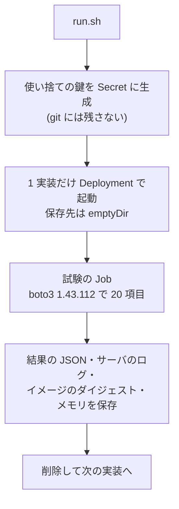

## はじめに

S3 互換を名乗る 4 つのオープンソース実装を、同じ k3s クラスタで 1 つずつ立て、同じ 20 項目の S3 リクエストを、最新の boto3 の既定の設定のまま投げました。結果は次のとおりです。

- 基本の操作(バケットの作成、PUT と GET、一覧、署名付き URL、コピー、一括削除)は、4 つとも通りました
- **Garage** は、タグ・バージョニング・バケットポリシー・Object Lock が未実装でした。条件付き書き込みでも上書きを止めませんでした
- **Garage のマルチパートアップロードは、SDK の既定のチェックサムでは失敗し、チェックサムを必要なときだけ付ける設定にすると成功**しました
- **MinIO** は、オープンソース版のリポジトリがアーカイブされ、コンテナイメージの配布も終わっています。今回はソースからビルドして試しました

「S3 互換」が何を指すのかは、別記事 `034-s3-protocol-deep-dive` で扱っています。

- 想定読者: 自前でオブジェクトストレージを立てる候補を比べている開発者
- 実施日: 2026-10-13(UTC)。各実装を 1 回ずつ試しました。性能・耐久性・複数ノードの構成は試していません(「試していないこと」の節)

:::message
本記事の文章生成・編集には AI (Anthropic Claude) を活用しています。試験は筆者の k3s クラスタで実行し、結果の JSON とサーバのログを証跡として残しています。誤りや改善点があれば、コメント等でご指摘ください。
:::

## 用語

本記事で使う S3 の機能の名前を、先に定義します。

- **path-style**: バケット名を URL のパスに入れる書き方(`http://host/bucket/key`)。ホスト名に入れる書き方は virtual-hosted-style と呼びます
- **チェックサムの設定**: boto3 の `request_checksum_calculation` という設定です。既定の `when_supported` では、対応している操作すべてに CRC32 などのチェックサムを付けます。`when_required` では、API が必須としている操作にだけ付けます([AWS SDKs and Tools: Data Integrity Protections](https://docs.aws.amazon.com/sdkref/latest/guide/feature-dataintegrity.html))
- **マルチパートアップロード**: 大きいファイルを複数のパートに分けて送り、最後に完了の要求で 1 つにまとめる方式
- **条件付き書き込み**: `If-None-Match: *` を付けた PUT です。同じキーのオブジェクトがまだ無いときだけ書き込み、あれば `412 Precondition Failed` で拒否します。複数のプログラムが同じキーに書くときの排他に使います
- **SSE-S3**: サーバ側の暗号化。`ServerSideEncryption: AES256` を付けると、ストレージ側の鍵で暗号化して保存します
- **Object Lock**: 指定した期間、オブジェクトの削除や上書きを禁止する機能
- **NotImplemented (501)**: 実装が「その操作は未実装」と返すときの S3 のエラーコード

## 試験の方法



| 項目 | 内容 |
|---|---|
| クラスタ | k3s v1.36.2+k3s1 |
| ノード | x86_64・8 コア・Ubuntu 26.04 LTS |
| 試験の環境 | boto3 1.43.112(Python 3.14) |
| アクセス方法 | path-style |
| チェックサム | 既定(`when_supported`) |
| 各実装の構成 | 単一ノード・単一プロセス |
| 保存先 | emptyDir |
| 同時に動かす数 | 1 つ |

- boto3 1.43.112 は実施時点の最新版です
- チェックサムは、比較のため一部の項目だけ `when_required` でも実行しました(項目名に明記)
- 同じノードで別のデータベースが動いているため、1 つずつ立てて、試験が終わるたびに消しました

試験した版です。

| 実装 | 版 | イメージのダイジェスト(先頭) |
|---|---|---|
| [SeaweedFS](https://github.com/seaweedfs/seaweedfs) | 4.48 | `sha256:4e61d15f…` |
| [RustFS](https://github.com/rustfs/rustfs) | 1.0.1 | `sha256:1803faef…` |
| [Garage](https://git.deuxfleurs.fr/Deuxfleurs/garage) | v2.4.1 | `sha256:9c96caa2…` |
| [MinIO](https://github.com/minio/minio) | RELEASE.2025-10-15T17-29-55Z | ソースからビルド(後述) |

## 結果

表の値は、成功なら `OK`、失敗なら返ってきた S3 のエラーコードと HTTP ステータスです。

| # | 項目 | SeaweedFS | RustFS | Garage | MinIO |
|---|---|---|---|---|---|
| T01 | バケットの作成 | OK | OK | OK | OK |
| T02 | バケットの一覧 | OK | OK | OK | OK |
| T03 | PUT(既定のチェックサム) | OK | OK | OK | OK |
| T04 | PUT(`when_required`) | OK | OK | OK | OK |
| T05 | GET(既定の応答の検証) | OK | OK | OK | OK |
| T06 | HEAD と範囲指定の GET | OK | OK | OK | OK |
| T07 | 一覧のページ送り | OK | OK | OK | OK |
| T08 | マルチパート(既定のチェックサム) | OK | OK | InvalidDigest / 400 | OK |
| T08b | マルチパート(`when_required`) | OK | OK | OK | OK |
| T09 | 署名付き URL の GET | OK | OK | OK | OK |
| T10 | コピー | OK | OK | OK | OK |
| T11 | 一括削除 | OK | OK | OK | OK |
| T12 | タグ | OK | OK | NotImplemented / 501 | OK |
| T13 | バージョニング | OK | OK | NotImplemented / 501 | OK |
| T14 | ライフサイクル設定 | OK | OK | OK | OK |
| T15 | 条件付き書き込み | OK | OK | 上書きされた | OK |
| T16 | バケットポリシー | OK | OK | NotImplemented / 501 | OK |
| T17 | CORS 設定 | OK | OK | OK | NotImplemented / 501 |
| T18 | SSE-S3 | InternalError / 500 | InvalidRequest / 400 | OK | NotImplemented / 501 |
| T19 | Object Lock | OK | OK | NotImplemented / 501 | OK |
| | 成功した項目の数 | 19 / 20 | 19 / 20 | 14 / 20 | 18 / 20 |

- T15 の「OK」は、2 回目の書き込みが `412` で拒否されたことを指します。「上書きされた」は、2 回目も成功して中身が置き換わったことを指します
- T08 と T08b は、5 MiB のパートを 2 つ送っています

## 差が出た項目

### Garage のマルチパートアップロードとチェックサム

既定の設定のまま 2 つのパートを送り、完了の要求を送ったところで失敗しました。返ってきたメッセージは次のとおりです。

```text
InvalidDigest (400): Invalid digest: Invalid checksum for part 1: in request = Some(Crc32([16, 82, 177, 163])), uploaded part = None
```

boto3 は既定で、各パートと完了の要求の両方に CRC32 のチェックサムを付けます。メッセージの `uploaded part = None` から、Garage はパートを受け取ったときのチェックサムを保持しておらず、完了の要求に付いた値と照合できずに拒否していると読めます(Garage のソースまでは確かめていません)。同じ手順を `when_required` で実行すると成功しました(T08b)。

回避するには、環境変数でチェックサムを必要なときだけ付けるようにします([AWS SDKs and Tools: Data Integrity Protections](https://docs.aws.amazon.com/sdkref/latest/guide/feature-dataintegrity.html))。

```bash
export AWS_REQUEST_CHECKSUM_CALCULATION=when_required
export AWS_RESPONSE_CHECKSUM_VALIDATION=when_required
```

1 回の PUT(T03)は既定のままでも通りました。小さいファイルだけの確認では見つからず、大きいファイルを分けて送ったときに初めて失敗する点に注意が必要です。2025 年に AWS SDK がチェックサムの既定を変えたときにも、互換実装へのアップロードの失敗が報告されています([aws-sdk-go-v2 の告知](https://github.com/aws/aws-sdk-go-v2/discussions/2960))。

### Garage の条件付き書き込み

SeaweedFS・RustFS・MinIO は、`If-None-Match: *` を付けた 2 回目の書き込みを `PreconditionFailed (412)` で拒否しました。Garage は 2 回目も成功し、オブジェクトは上書きされました。エラーにならないので、この指定で排他をしているプログラムを Garage に載せると、競合を検知できません。

### Garage の未実装の操作

タグ・バージョニング・バケットポリシー・Object Lock は、`NotImplemented (501)` でした。メッセージは `Unimplemented action: PutObjectTagging` のように、どの操作が未実装かを示しています。

Garage は、小規模な自前運用と地理的な分散を設計の目標にしていて、冗長化も複製だけに絞っています。

> Storage optimizations: erasure coding or any other coding technique both increase the difficulty of placing data and synchronizing; we limit ourselves to duplication.
>
> — [Garage: Goals and use cases](https://garagehq.deuxfleurs.fr/documentation/design/goals/)、2026-10 時点で取得

### 鍵を設定していないときの SSE-S3

4 つとも、暗号化の鍵を何も設定しない状態で試しました。

| 実装 | エラーコード | 応答で原因がわかるか |
|---|---|---|
| SeaweedFS | InternalError / 500 | わからない |
| RustFS | InvalidRequest / 400 | わかる |
| MinIO | NotImplemented / 501 | わかる |
| Garage | (成功) | — |

- SeaweedFS の応答は汎用のメッセージだけでした。サーバのログには `putVersionedObject failed with errCode=30` が出ていました
- RustFS の応答は `SSE-S3 requires RUSTFS_SSE_S3_MASTER_KEY to be set to a base64-encoded 32-byte key when KMS is not configured` で、必要な設定を示しています
- MinIO の応答は `Server side encryption specified but KMS is not configured` でした
- Garage は要求を受け付けました。保存時に実際に暗号化されたかは確かめていません

### MinIO の CORS

MinIO は CORS の設定に `NotImplemented (501)` を返しました(`A header you provided implies functionality that is not implemented`)。ほかの 3 つは、設定と取得の両方ができました。

## 実装の違い

試験とは別に、各リポジトリの公開情報で確認した違いです(2026-10-13 時点)。

| | SeaweedFS | RustFS | Garage | MinIO |
|---|---|---|---|---|
| 言語 | Go | Rust | Rust | Go |
| ライセンス | Apache-2.0 | Apache-2.0 | AGPL-3.0 | AGPL-3.0 |
| 開発 | 活発 | 活発 | 活発 | アーカイブ済み |
| 冗長化 | 複製・消失訂正符号 | 消失訂正符号 | 複製のみ | 消失訂正符号 |
| Iceberg カタログ | 内蔵 | 内蔵(Preview) | なし | なし |
| S3 以外の窓口 | POSIX・WebDAV | FTPS・WebDAV | なし | なし |

- SeaweedFS は、ボリュームサーバに小さいファイルをまとめて詰める設計で、POSIX のファイルシステムや Iceberg のテーブル(S3 Tables)も同じデータで提供します([README](https://github.com/seaweedfs/seaweedfs))
- RustFS は、README に Erasure Set の構成が書かれています。S3 Tables(Iceberg REST カタログ)は `🧪 Preview` です([README](https://github.com/rustfs/rustfs))
- MinIO の消失訂正符号は、[MinIO Erasure Code Overview](https://docs.min.io/community/minio-object-store/operations/concepts/erasure-coding.html) に説明があります(現在は AIStor の文書へ転送されます)
- Iceberg のカタログを内蔵していない実装も、外部のカタログと組み合わせれば、Iceberg のデータの置き場所として使えます。内蔵のカタログは今回試していません
- SeaweedFS は、既定は複製で、ボリューム単位で消失訂正符号に変換する機能も持っています(ソースの [`weed/storage/erasure_coding`](https://github.com/seaweedfs/seaweedfs/tree/master/weed/storage/erasure_coding) と、変換するシェルのコマンド [`ec.encode`](https://github.com/seaweedfs/seaweedfs/blob/master/weed/shell/command_ec_encode.go))

### MinIO の配布の状況

MinIO のリポジトリの README は、冒頭で保守の終了を告げています。

> THIS REPOSITORY IS NO LONGER MAINTAINED.
>
> — [minio/minio README](https://github.com/minio/minio)、2026-10 時点で取得

代わりに案内されているのは、商用の AIStor(無償版と有償版)です。最後のリリースのノートは、コンテナについて次のように書いています。

> For container environments, please clone the source and build the latest container.
>
> — [minio/minio Releases: RELEASE.2025-10-15T17-29-55Z](https://github.com/minio/minio/releases/tag/RELEASE.2025-10-15T17-29-55Z)、2026-10 時点で取得

Docker Hub の `minio/minio` も、2026-10-13 時点で取得できませんでした(「object not found」)。今回は、上流の Makefile と同じビルドの指定(`CGO_ENABLED=0`、`-tags kqueue`、`-trimpath`、版の情報を埋め込む ldflags)で、リリースのタグからイメージを作りました。ビルドの定義も証跡のリポジトリに置いています。

## 起動時間とメモリ

各 1 回の計測です。メモリは、試験の約 30 秒後に `kubectl top` で 1 度だけ読んだ値です。

| 実装 | Ready までの秒数 | メモリ(MiB) | イメージ(MiB) |
|---|---|---|---|
| SeaweedFS | 5 | 163 | 184.6(圧縮後) |
| RustFS | 2 | 54 | 106.0(圧縮後) |
| Garage | 2 | 6 | 26.8(圧縮後) |
| MinIO | 16 | 84 | 227.5(展開後) |

- 「Ready までの秒数」は、Deployment を作ってから readiness probe が通るまでの時間です
- MinIO のイメージは自前のビルドで、展開後の大きさしか測っていないため、ほかの 3 つと基準が違います
- 保存したデータは数十 MiB だけです。データが増えたときのメモリは別です

## 選び方

| 条件 | 候補 |
|---|---|
| タグ・バージョニング・Object Lock を使う | SeaweedFS、RustFS |
| ライセンスを Apache-2.0 にしたい | SeaweedFS、RustFS |
| 小さな機械を拠点ごとに置く | Garage |
| 新しく採用する | MinIO 以外 |

- タグなどを使う場合: 今回の 20 項目のうち 19 項目が成功したのは SeaweedFS と RustFS です
- Garage を選ぶ場合: メモリは 6 MiB と最小でした。タグ・バージョニング・Object Lock・条件付き書き込みに頼らないアプリに限られます。マルチパートを使うなら、チェックサムを `when_required` にします
- MinIO: オープンソース版は、保守もイメージの配布も終わっています

どれを選ぶにしても、自分のアプリが使う操作を、実際に投げて確かめるのが確実です。試験のスクリプトは証跡のリポジトリにあり、エンドポイントと鍵を変えれば、ほかのストレージにも流せます。

## 試していないこと

- **性能**: 速度や同時接続の比較はしていません
- **耐久性と複数ノードの構成**: 4 つとも単一ノードで試しました
- **virtual-hosted-style**: ワイルドカードの DNS を用意していないため、path-style だけで試しました
- **内蔵の Iceberg カタログ**: SeaweedFS と RustFS のカタログは試していません
- **鍵を設定した SSE-S3**: 暗号化の鍵を設定した状態は試していません

## まとめ

- 4 つとも基本の操作は通りました。差が出たのは、タグ・バージョニング・ポリシー・Object Lock・条件付き書き込み・暗号化・CORS です
- Garage は 14 / 20 でした。未実装の操作は 501 で示されますが、条件付き書き込みはエラーにならずに上書きし、マルチパートは SDK の既定のチェックサムで失敗します
- SeaweedFS と RustFS は 19 / 20 でした。どちらも Apache-2.0 で、Iceberg のカタログも内蔵しています
- MinIO は 18 / 20 でしたが、オープンソース版は保守もイメージの配布も終わっています
- 「S3 互換」という表示だけで選ばず、使う操作を実際に投げて確かめるのが確実です

## 参考

- 検証時の構成ファイル: [s3-compat-lab(マニフェスト・試験スクリプト・結果の JSON・サーバのログ)](https://github.com/shinichitazawa/k8s-deploy-public/tree/main/s3-compat-lab)

- [SeaweedFS](https://github.com/seaweedfs/seaweedfs) / [RustFS](https://github.com/rustfs/rustfs) / [Garage(本体)](https://git.deuxfleurs.fr/Deuxfleurs/garage) / [MinIO](https://github.com/minio/minio)
- [Garage: Goals and use cases](https://garagehq.deuxfleurs.fr/documentation/design/goals/) / [Garage Quick Start](https://garagehq.deuxfleurs.fr/documentation/quick-start/)
- [minio/minio Releases: RELEASE.2025-10-15T17-29-55Z](https://github.com/minio/minio/releases/tag/RELEASE.2025-10-15T17-29-55Z) / [MinIO Erasure Code Overview](https://docs.min.io/community/minio-object-store/operations/concepts/erasure-coding.html)
- [AWS SDKs and Tools: Data Integrity Protections](https://docs.aws.amazon.com/sdkref/latest/guide/feature-dataintegrity.html) / [aws-sdk-go-v2 の告知(チェックサムの既定の変更)](https://github.com/aws/aws-sdk-go-v2/discussions/2960)
- [boto3](https://github.com/boto/boto3)
